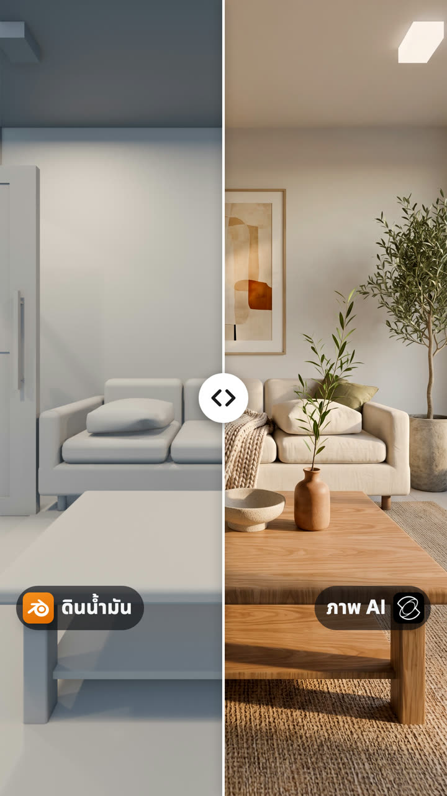
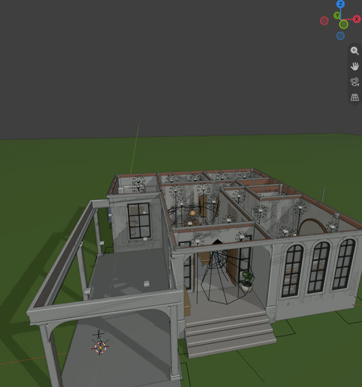
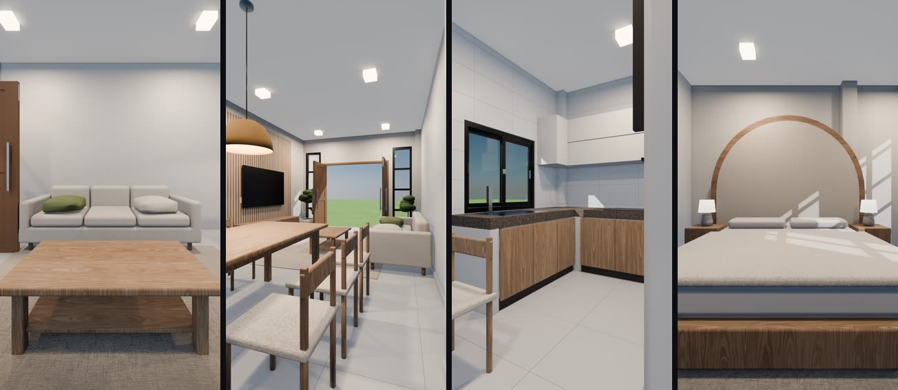
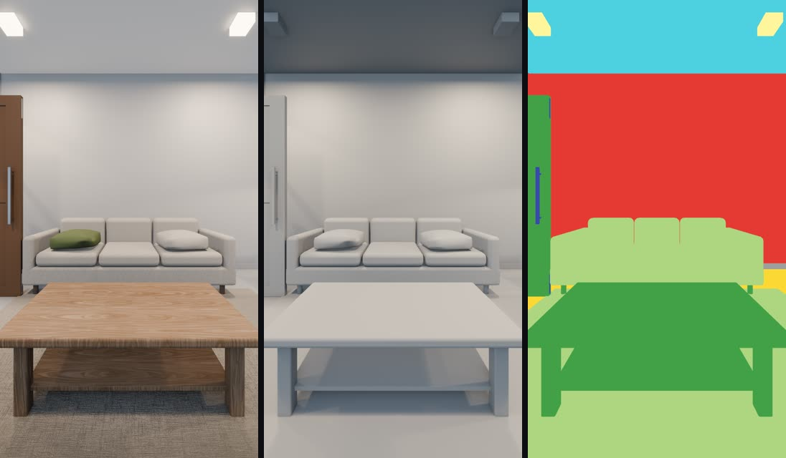
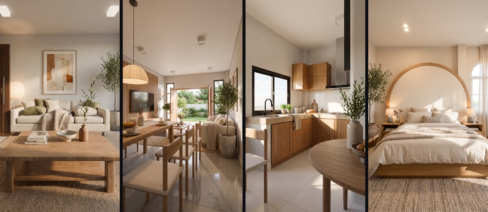
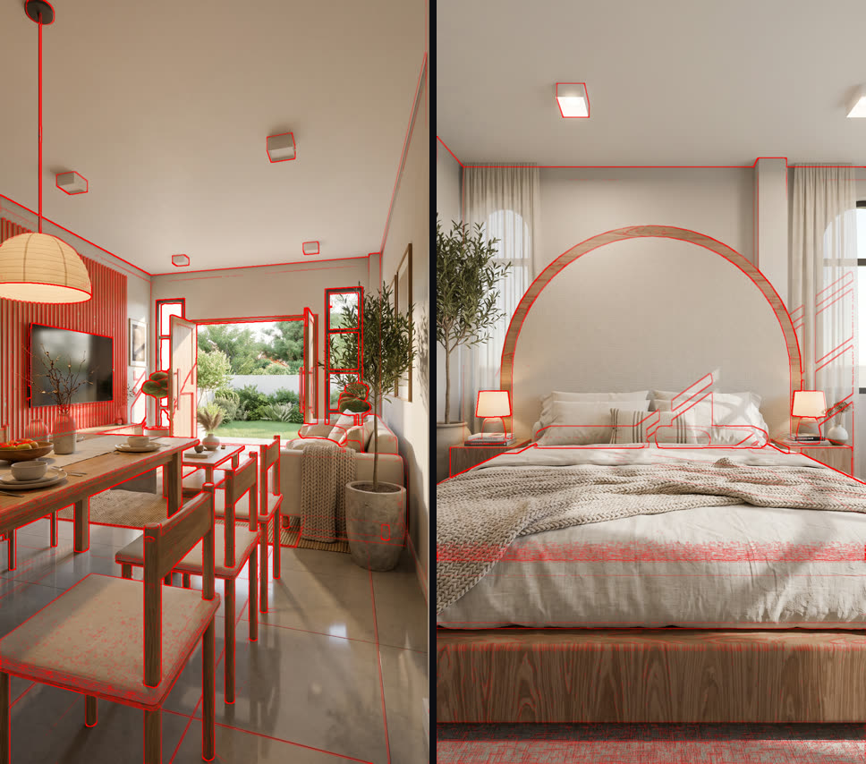
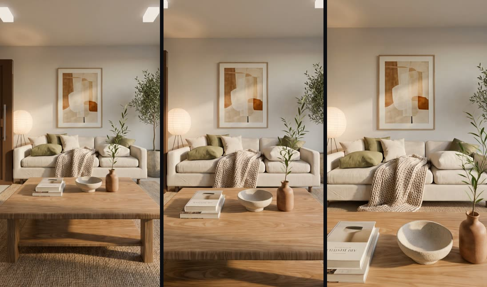
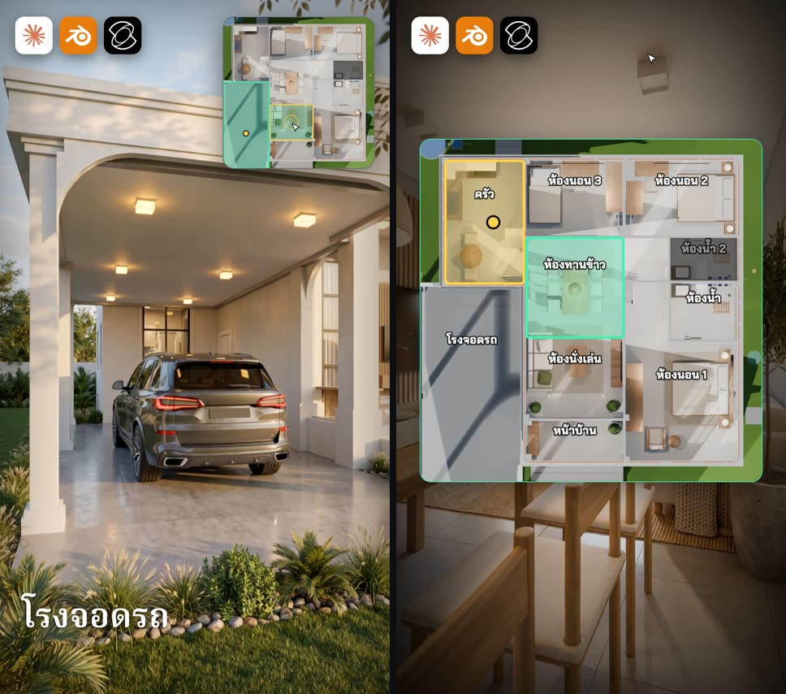

# nuea.ai House Render · Skill render บ้านให้สมจริงจาก Blender ด้วย Claude

> **For Claude and other AI agents:** to install this skill, follow [INSTALL.md](INSTALL.md)
> (raw: https://raw.githubusercontent.com/HaNorthRich/nuea-ai-house-render-skill/main/INSTALL.md).

<p align="center">
  
</p>

Skill ตัวนี้ผมทำขึ้นมาจากคลิป EP6 ครับ ซึ่งจะเอาบ้านที่ปั้นไว้ใน Blender ที่ยังดูเป็นดินน้ำมันอยู่
มาทำเป็นภาพและคลิปที่ดูเหมือนถ่ายจริง โดย**ผนัง ประตู หน้าต่าง ยังอยู่ที่เดิมทุกห้อง**
แล้วยังได้หน้าเว็บแผนที่แบบเกมด้วยครับ คลิกห้องไหนก็ไปห้องนั้นได้เลย

หน้านี้ผมเขียนไว้ให้คนที่เพิ่งโหลด Skill ไปครับ ทำตามทีละขั้นได้เลย ทุกขั้นจะมีรูปให้ดูว่าได้อะไร และมีข้อความให้ก๊อปไปพิมพ์สั่ง Claude

## ก่อนเริ่ม ต้องมีอะไรบ้าง

- **Blender** 4.2 ขึ้นไป ([โหลดฟรี](https://www.blender.org/download/))
- **Claude Code** ใช้กับแพ็กเกจเสียเงินของ Claude (Pro ขึ้นไป) หรือ API key แพ็กเกจฟรีใช้ไม่ได้ (ณ พ.ย. 2569 · [ดูแพ็กเกจ](https://claude.com/pricing))
  เปิดได้ทั้งในแอป Claude บนคอมพิวเตอร์ (แท็บ Code) และใน terminal
- **ไฟล์ .blend ของบ้านที่ตกแต่งแล้ว** มีเฟอร์นิเจอร์ครบ หน้าตาแบบในรูปด้านล่างก็ใช้ได้ ไม่ต้องสวยครับ
  ถ้าปั้นด้วย Skill ปั้นบ้านใน Blender ของช่อง nuea.ai จะยิ่งง่าย (ดูหัวข้อถัดไป)

## ใช้คู่กับ Skill ปั้นบ้านใน Blender · Claude จัดห้องและวัสดุให้เอง

Skill ปั้นบ้านของช่อง nuea.ai ซ่อน**ลายน้ำของช่อง**ไว้ในไฟล์ .blend ครับ คือชื่อกลุ่มตามขั้นงาน เช่น `ST06 Walls` (ผนัง) `ST08 Ceiling` (ฝ้า)
`ST14 Doors Windows` (ประตูหน้าต่าง) หรือกลุ่ม `Walls` กับ `Openings` ของโมเดลขาย Skill render ตัวนี้อ่านลายน้ำนั้นออก แล้วทำ 2 อย่างให้เอง

| ทำอะไรให้ | เดิมต้องทำเอง |
|---|---|
| **หาห้องทุกห้องจากผนัง** บอกขนาด ตั้งชื่อตามเฟอร์นิเจอร์ในห้อง (มีเตียงคือห้องนอน มีชักโครกคือห้องน้ำ) และจับคู่กับมุมกล้อง | Claude ต้องเขียนพิกัดห้องลง `rooms.json` ทีละห้อง |
| **จัดกลุ่มวัสดุให้ Material ID map** วัสดุที่ชื่อไม่บอกว่าเป็นอะไร เช่น `M_Gypsum` ดูจากขั้นงานที่ใช้มัน ถ้าอยู่ขั้นฝ้าก็เป็นฝ้า | Claude ต้องเดาจากชื่อ ที่เดาไม่ออกก็เป็นสีเทา |

ตอนผมลองกับบ้าน SS-02 จากคลิป EP5 Claude หาห้องเจอครบ 9 ห้อง จับคู่มุมกล้องได้ทั้ง 7 มุม และวัสดุที่เป็นสีเทาลดจาก 21 เหลือ 7 อย่าง
ส่วนที่เหลือเป็นวัสดุของเฟอร์นิเจอร์ ซึ่ง Claude ไม่เดาให้ครับ

บ้านที่ปั้นด้วยวิธีอื่นก็ใช้ Skill นี้ได้เหมือนเดิมทุกอย่าง แค่ Claude จะจัดห้องกับวัสดุให้แบบเดิม คือดูจากชื่อและถามเรา
- **ทางทำภาพ เลือก 1 ทาง** (เพิ่มอีกทางทีหลังได้)
  - **Kling** เสียเงิน (ใช้เครดิต Kling) แต่ Claude ทำให้ทั้งหมด
  - **Google Flow** มีโควตาฟรีรายวัน แต่คุณต้องอัปโหลดและกดเองบนเว็บ Claude เตรียมไฟล์กับ prompt ให้

<p align="center">
  
</p>

## ขั้นที่ 0 · ติดตั้ง (ให้ Claude ลงให้)

1. ลง Blender และเปิด Claude Code
2. ส่งข้อความนี้ให้ Claude

   ```
   ลง Skill นี้ให้หน่อย https://github.com/HaNorthRich/nuea-ai-house-render-skill
   ```

3. Claude จะเช็ก Blender กับ ffmpeg ลง Skill แล้วถามว่าจะทำภาพด้วย Kling หรือ Google Flow ตามขั้นตอนใน [INSTALL.md](INSTALL.md)
   ในโหมดปกติ Claude Code จะขอให้เรากดอนุญาตก่อนรันแต่ละคำสั่งครับ อ่านคำสั่งก่อนกด Allow ทุกครั้งนะครับ
4. ตอนจบ Claude จะทดสอบกับห้องตัวอย่าง (ไม่เสียเครดิต ประมาณ 1 นาที) แล้วบอกว่าต่อไปมีอะไรที่เราต้องทำเอง
   - **ปิด Claude Code ให้สนิทแล้วเปิดใหม่** เพราะ Skill จะโหลดตอนเปิด session ใหม่เท่านั้นครับ
   - ถ้าเลือก Kling: พิมพ์ `/mcp` → **klingai** → **Authenticate** แล้วล็อกอิน Kling
   - ถ้าลง Blender MCP ด้วย (ไม่บังคับ แต่ผมแนะนำครับ): ใน Blender ไปที่ **Edit → Preferences → Add-ons** เปิด **MCP for Blender**
     แล้วกด **N** ในหน้าจอ 3D → แท็บ **MCP for Blender** → **Start MCP Server**

## ใช้งานทีละขั้น

ทุกอย่างที่ Skill ทำจะอยู่ในโฟลเดอร์ `<ชื่อบ้าน>_render/` ข้างไฟล์ .blend ของคุณ Skill ไม่เซฟทับไฟล์ .blend
แต่ผมแนะนำให้สำรองไฟล์ไว้ก่อนเริ่มนะครับ

### ขั้นที่ 1 · บอก Claude ว่าจะทำบ้านหลังไหน

```
ทำภาพบ้านหลังนี้ให้สมจริง จัดมุมกล้องแบบภาพ Pinterest ทุกห้อง <path ของไฟล์ .blend>
```

Claude จะเปิดไฟล์ เช็กเครื่องมือ แล้วถามเรา 2 เรื่องครับ

- จะทำภาพด้วย **Kling** หรือ **Google Flow**
- อยากได้สไตล์แบบไหน ส่งรูปสไตล์ที่คุณมีสิทธิ์ใช้ หรือพิมพ์บอกเป็นคำก็ได้ เช่น `สไตล์ Japandi โทนไม้อ่อน ผ้าลินินสีครีม มีต้นไม้`

### ขั้นที่ 2 · เลือกมุมกล้อง

<p align="center">
  
</p>

Claude จะตั้งกล้องแบบภาพถ่ายตกแต่งภายในครับ คือกล้องตั้งตรง เลนส์ 16–24 มม. สูงราว 1 เมตร และจัดเฟรมที่โซฟา หัวเตียง หรือโต๊ะ
แล้วเสนอห้องละ 2 มุมเป็นภาพเล็กให้เราเลือก ชอบมุมไหนบอกได้เลยครับ หรือสั่งแก้ก็ได้
ถ้าบ้านปั้นด้วย Skill ปั้นบ้าน Claude จะอ่านลายน้ำก่อน เลยรู้ว่ามีห้องอะไรบ้าง ขนาดเท่าไหร่ และมีเฟอร์นิเจอร์อะไร ก่อนตั้งกล้องครับ

```
ห้องนั่งเล่นเอามุมที่ 2 ส่วนห้องนอนขยับกล้องให้เห็นหัวเตียงเต็มๆ
```

### ขั้นที่ 3 · ภาพ 3 แบบต่อมุม

<p align="center">
  
</p>

ทุกมุมจะได้ 3 ภาพครับ

| ภาพ | ใช้ทำอะไร |
|---|---|
| ภาพปกติ | ภาพหลักที่ส่งให้ AI |
| ภาพดินน้ำมัน | ไว้ทำปก before/after |
| **Material ID map** | ทาสีเรียบให้ทุกพื้นผิว สีบอกว่าเป็นวัสดุอะไร พร้อมตารางสี (`legend.json`) |

ที่ต้องมี Material ID map เพราะตอนผมทดลองกับบ้านจริง AI ขยับมุมกล้องเอง แล้วก็เปลี่ยนพื้นห้องน้ำด้วยครับ
แต่พอส่ง ID map ไปด้วย เส้นแดงก็ทับตรงทุกเส้น และวัสดุก็วางถูกที่ตามสี

ถ้าเห็นพื้นที่ใหญ่ๆ เป็นสีเทา แปลว่า Claude ยังไม่รู้ว่าเป็นวัสดุอะไร บอกได้เลยครับ (บ้านจาก Skill ปั้นบ้าน Claude จัดกลุ่มวัสดุให้ไว้ก่อนแล้วใน `groups.json`)

```
ผนังห้องนี้เป็นปูนฉาบทาสีขาว ส่วนพื้นเป็นกระเบื้องสีเทาด้าน
```

### ขั้นที่ 4 · ทำภาพสมจริง

<p align="center">
  
</p>

Claude จะเขียน prompt ห้องละ 1 ชุดให้เอง ทำห้องแรกให้เราดูก่อน แล้วค่อยทำห้องที่เหลือครับ
ของที่เป็นกล่องในโมเดล (ชักโครก ฝักบัว รถ) จะกลายเป็นของจริงที่ตำแหน่งเดิม

- **Kling:** ก่อนกดทุกครั้ง Claude จะบอกว่ามีกี่งาน ใช้กี่เครดิต แล้วรอให้คุณตอบว่าได้ก่อน
- **Google Flow:** Claude เตรียมไฟล์ให้ทีละห้องในโฟลเดอร์ `flow_pack/<ห้อง>/` แล้วเราทำต่อบนเว็บตามนี้
  1. เปิด https://labs.google/flow → **New project**
  2. **Image** → เลือก **Nano Banana Pro** (ถ้าโควตา Pro หมด ใช้ Nano Banana 2.1) · แนวตั้ง 9:16 · ใส่ภาพตามลำดับ `1_render.png` → `2_idmap.png` → (`3_style.jpg` ถ้ามี)
  3. วางข้อความจาก `prompt_image.txt` แล้วกด **Generate** ลอง 2–3 รอบต่อห้องเป็นเรื่องปกติครับ
  4. โหลดภาพที่ชอบที่สุด ตั้งชื่อ `<ห้อง>_real.png` (ชื่อห้องตามชื่อโฟลเดอร์) เซฟไว้ใน `flow_pack/<ห้อง>/` แล้วบอก Claude ให้ตรวจในขั้นที่ 5

```
เตรียมไฟล์ไปทำต่อใน Google Flow ทีละห้องให้หน่อย
```

### ขั้นที่ 5 · ตรวจว่าเป็นบ้านหลังเดิม

<p align="center">
  
</p>

Claude จะเอาเส้นขอบจาก Blender สีแดงมาซ้อนบนภาพ AI ครับ ห้องไหนที่ AI แอบเปลี่ยน จะเห็นทันทีเลย

- ภาพซ้าย: เส้นแดงทับตรงทุกเส้น ผ่านครับ
- ภาพขวา: AI แอบเติมหน้าต่างทางซ้ายที่แบบไม่มี เลยไม่มีเส้นแดงทับ ห้องนี้ต้องทำใหม่ครับ

```
ตรวจเส้นแดงทุกห้องให้หน่อย ห้องไหนไม่ตรงบอกผมด้วย
```

ห้องที่ไม่ผ่าน Claude จะบอกว่าต้องแก้อะไร ถ้าใช้ Kling ก็จะถามก่อนทุกครั้งที่ต้องใช้เครดิตครับ

### ขั้นที่ 6 · ทำคลิป 5 วินาที

<p align="center">
  
</p>

ต่อมาเราเอาภาพที่ผ่านแล้วไปทำคลิปห้องละ 5 วินาทีครับ โดยกล้องจะเคลื่อนไม่ซ้ำกันทุกห้อง เช่น ห้องนั่งเล่นค่อยๆ เคลื่อนเข้าหาโซฟา
ส่วนครัวเลื่อนไปตามเคาน์เตอร์ แล้ว Claude จะดูทุกคลิปให้ว่ามีของโผล่ หาย หรือบิดเบี้ยวไหม

```
เอาภาพที่ผ่านแล้วไปทำคลิป 5 วิทุกห้อง กล้องเคลื่อนไม่ซ้ำกัน
```

- **Kling:** ได้คลิป 1080p ครับ และ Claude จะบอกเครดิตก่อนเหมือนเดิม
- **Google Flow:** ใช้ **Frames to Video** · ภาพแรก = `<ห้อง>_real.png` · 9:16 · **Omni Flash 1.2** · 5 วิ · 720p
  วางข้อความจาก `prompt_video.txt` ดูเครดิตบนปุ่ม Generate ก่อนกด แล้วโหลดคลิปมาเป็น `<ห้อง>.mp4`
  โควตาฟรีทำได้ประมาณวันละ 3 ห้อง และช่วงราว 3–4 ทุ่มถึงเที่ยงคืน (เวลาไทย) บัญชีฟรีอาจทำวิดีโอไม่ได้ ช่วงนั้นทำภาพไปก่อนได้ครับ

บ้านหลายห้องเลยต้องทำต่อหลายวัน วันถัดไปเปิด session ใหม่ แล้วพิมพ์แบบนี้ได้เลยครับ

```
ทำต่อด้วย Skill nuea-ai-house-render จากโฟลเดอร์ <path ของ ชื่อบ้าน_render> ห้องไหนยังไม่มีคลิปทำต่อให้หน่อย
```

### ขั้นที่ 7 · แผนที่แบบเกม

<p align="center">
  
</p>

```
ทำหน้าแผนที่แบบเกมให้หน่อย คลิกห้องไหนก็ไปห้องนั้น
```

Claude จะทำหน้าเว็บไว้ในโฟลเดอร์ `walkthrough/` แล้วเราเปิด `index.html` ด้วย Chrome ลองเล่นได้เลยครับ ถ้าจะส่งให้ใครดู ต้องส่งไปทั้งโฟลเดอร์
บ้านจาก Skill ปั้นบ้าน Claude จะวางกรอบห้องบนผังให้เองจากผนังจริง ส่วนห้องที่ไม่มีผนังกั้น เช่น ห้องนั่งเล่นต่อกับห้องทานข้าว Claude จะแบ่งกรอบให้ตามมุมกล้อง

- คลิกห้องบนผัง → จุดเดินไปตามทางเดิน → คลิปห้องนั้นเล่น
- กด **B** ค้างไว้ = ดูภาพ Blender มุมเดียวกัน
- ตัวคลิปจะเดินตามเส้นทางกล้องที่ทำไว้นะครับ เดินอิสระไม่ได้

## รวม prompt ไว้ก๊อปไปใช้

| อยากทำ | พิมพ์บอก Claude |
|---|---|
| ติดตั้ง | `ลง Skill นี้ให้หน่อย https://github.com/HaNorthRich/nuea-ai-house-render-skill` |
| เริ่มทำบ้าน | `ทำภาพบ้านหลังนี้ให้สมจริง จัดมุมกล้องแบบภาพ Pinterest ทุกห้อง <path ของไฟล์ .blend>` |
| บอกสไตล์ | `สไตล์ Japandi โทนไม้อ่อน ผ้าลินินสีครีม มีต้นไม้` |
| แก้มุมกล้อง | `ห้องนั่งเล่นเอามุมที่ 2 ส่วนห้องนอนขยับกล้องให้เห็นหัวเตียงเต็มๆ` |
| ทำแค่ ID map | `ทำ Material ID map ของทุกมุมกล้อง แล้วเตรียมไฟล์ไปทำต่อใน Google Flow` |
| ตรวจเส้น | `ตรวจเส้นแดงทุกห้องให้หน่อย ห้องไหนไม่ตรงบอกผมด้วย` |
| ทำคลิป | `เอาภาพที่ผ่านแล้วไปทำคลิป 5 วิทุกห้อง กล้องเคลื่อนไม่ซ้ำกัน` |
| ทำแผนที่ | `ทำหน้าแผนที่แบบเกมให้หน่อย คลิกห้องไหนก็ไปห้องนั้น` |
| ทำต่อวันถัดไป | `ทำต่อด้วย Skill nuea-ai-house-render จากโฟลเดอร์ <path ของ ชื่อบ้าน_render> ห้องไหนยังไม่มีคลิปทำต่อให้หน่อย` |

<details>
<summary><b>Prompt ภาษาอังกฤษที่ Claude ส่งให้ AI ทำภาพ</b> (ฉบับย่อ เผื่ออยากรู้ว่าสั่งอะไร)</summary>

นี่คือฉบับย่อครับ ฉบับเต็มที่ Claude เติมส่วน `<…>` ให้แล้วอยู่ในไฟล์ `prompt_image.txt` ของแต่ละห้อง (ทาง Google Flow) ส่วนแม่แบบเต็มอยู่ที่
[`nuea-ai-house-render/references/prompts.md`](nuea-ai-house-render/references/prompts.md)

```
Image 1 is a 3D render of a real house <room, e.g. master bedroom, front view of the bed>.
Image 2 is its Material ID map: the same camera, every surface painted one flat colour that tells you its material.
Colour legend: <one line per legend group present in this room, e.g. red = white painted walls; yellow = light grey
matte floor tiles; cyan = white ceiling; green = natural oak wood>.
Create a photorealistic, magazine-quality interior photograph of the exact room in Image 1, styled in <style>.
Use Image 2 to place each material exactly where its colour is; do not show any colour from Image 2 in the result.
KEEP EXACTLY: the camera position, angle and framing (do not zoom, do not rotate, do not recompose), every wall, the
ceiling and its lights, every window, door and opening, and the position, size and shape of <main furniture list>.
Objects that are simple blocky placeholders become realistic high-end versions at exactly the same position and size.
ADD styling only in empty space, never blocking a window or door.
Realism: soft natural daylight with gentle shadows, real material textures, full-frame camera 24mm,
vertical lines perfectly straight. No people, no text, no watermark.
```

คลิป: ทุกท่ากล้องลงท้ายด้วย *The room stays exactly the same: no objects appear, disappear, move or change shape.*

</details>

## ทำภาพ/คลิปได้ 2 ทาง

| | Kling (ผ่าน MCP) | Google Flow (บนเว็บ) |
|---|---|---|
| ค่าใช้จ่าย | เสียเงิน (ใช้เครดิต Kling) · ที่เราวัดได้บนแพ็กเกจ Standard (พ.ย. 2569): ภาพละ ~2–20 เครดิตตามรุ่น คลิป 5 วิ ~50 | มีโควตาฟรีรายวัน (ประมาณการ ณ 8 พ.ย. 2569): วิดีโอ ~3 ห้อง/วัน ที่ 720p ตามหน้าช่วยเหลือของ Google · ภาพหลายสิบภาพ/วัน ตามการทดสอบของบล็อกภายนอก (Google ไม่ได้ประกาศตัวเลขนี้) |
| ใครกด | Claude ทำให้ทั้งหมด | Claude เตรียมไฟล์ + prompt ให้ คุณอัปโหลดและกดเอง |
| ความละเอียดคลิป | 1080p | 720p (ฟรี) |

ตัวเลขในตารางนี้คือค่าที่เราวัดหรืออ่านได้ ณ พ.ย. 2569 ไม่ใช่ราคาหรือโควตาทางการ Kling และ Google เปลี่ยนได้ทุกเมื่อ
ดูเครดิตบนปุ่ม Generate (Flow) หรือยอดในบัญชี Kling ก่อนกดทุกครั้ง ค่าเครดิตที่ใช้ไปเป็นของบัญชีคุณเอง

## เจอปัญหา ลองแบบนี้

| อาการ | ทางแก้ |
|---|---|
| พิมพ์สั่งแล้ว Claude ไม่รู้จัก Skill | ปิด Claude Code ให้สนิทแล้วเปิดใหม่ครับ เพราะ Skill จะโหลดตอนเริ่ม session |
| Claude บอกว่าต่อ Blender ไม่ได้ | ทำต่อได้ครับ สคริปต์รันแบบเบื้องหลังได้โดยไม่ต้องมี MCP แต่ถ้าอยากให้ Claude ดูฉากสดด้วย ให้เปิด add-on แล้วกด **Start MCP Server** (ขั้นที่ 0) |
| Kling ยังไม่ได้ล็อกอิน | พิมพ์ `/mcp` → **klingai** → **Authenticate** |
| ภาพ AI ขยับมุมกล้องหรือเปลี่ยนวัสดุ | ส่ง Material ID map ไปด้วยทุกครั้งครับ แล้วตรวจเส้นแดงในขั้นที่ 5 |
| ภาพดินน้ำมันมืดกว่าภาพปกติ | ปกติครับ ภาพดินน้ำมันปิดกระจกหน้าต่างด้วย ห้องที่มีแต่แสงแดดเลยจะมืดลง |
| Google Flow ทำวิดีโอไม่ได้ | ช่วงราว 3–4 ทุ่มถึงเที่ยงคืน บัญชีฟรีอาจถูกพักวิดีโอ ทำภาพไปก่อน แล้วค่อยทำวิดีโอช่วงอื่นครับ |

## ในชุดมีอะไร

| ที่อยู่ | คืออะไร |
|---|---|
| `nuea-ai-house-render/SKILL.md` | ขั้นตอนหลัก 7 ขั้นที่ Claude ทำตาม |
| `nuea-ai-house-render/references/` | กฎมุมกล้อง · prompt ที่ใช้ได้ผล · วิธีใช้ Kling · วิธีใช้ Google Flow · วิธีตรวจเส้นแดงและสิ่งที่ AI ชอบแอบเปลี่ยน |
| `nuea-ai-house-render/scripts/` | `cameras.py` (ภาพปกติ/ดินน้ำมัน) · `idmap.py` (Material ID map) · `plan_map.py` (ผังสำหรับแผนที่) · `house_mark.py` (อ่านลายน้ำของ Skill ปั้นบ้าน จัดห้องและกลุ่มวัสดุให้) · `overlay.sh` (ซ้อนเส้นแดง) · `_common.py` (ส่วนที่สคริปต์ใช้ร่วมกัน) |
| `nuea-ai-house-render/walkthrough/` | หน้าเว็บแผนที่แบบเกม |
| `nuea-ai-house-render/examples/` | ห้องตัวอย่างไว้ทดสอบหลังติดตั้ง |
| `docs/images/` | รูปในหน้านี้ จากบ้านทดลองในคลิป EP6 |

## ข้อควรรู้

- ภาพที่ได้เป็น**ภาพจำลองจาก AI ไม่ใช่แบบก่อสร้างหรือรายการวัสดุ** ใช้ให้ลูกค้าเห็นภาพได้ แต่ต้องเทียบกับแบบทุกห้อง
  (AI แอบเติมของได้ เช่น หน้าต่างที่แบบไม่มี) อย่าแนบภาพนี้เป็นส่วนหนึ่งของสัญญาหรือสเปกงาน
- ถ้าใช้ในโฆษณาขายบ้าน/คอนโด ภาพถือเป็นข้อความโฆษณา: ของที่ไม่มีจริงในแบบ (หน้าต่าง ทางเดิน สวน วิว) ให้แก้ภาพออก
  การเขียนกำกับใช้แทนไม่ได้ · เฟอร์นิเจอร์และของตกแต่งที่ไม่รวมในราคา ให้เขียนกำกับบนภาพหรือติดภาพ
- ตอนโพสต์ให้เปิดป้ายเนื้อหา AI ของแพลตฟอร์ม (เช่น YouTube: Altered or synthetic content · Instagram/Facebook: ป้าย AI —
  ชื่อเมนูอาจเปลี่ยน) และใส่คำว่า "ภาพจำลองจาก AI" บนภาพด้วย เพราะป้ายของแพลตฟอร์มไม่ติดไปเมื่อภาพถูกส่งต่อใน LINE
  หรือโบรชัวร์ · อย่าตัดหรือลบลายน้ำของผู้ให้บริการ
- ภาพสไตล์ที่ใช้อ้างอิง ใช้เฉพาะรูปที่คุณมีสิทธิ์ใช้ (ถ่ายเอง ซื้อสิทธิ์ หรือเจ้าของอนุญาต) การอัปโหลดรูปของคนอื่นขึ้น
  Kling/Google ก็นับเป็นการทำสำเนาแล้ว และอย่าให้รูปนั้นติดในงานที่เผยแพร่
- ไฟล์ที่ส่งไป Kling หรือ Google จะอยู่บนเซิร์ฟเวอร์ของผู้ให้บริการตามเงื่อนไขของเขา ถ้าเป็นแบบบ้านของลูกค้า ให้ขออนุญาตลูกค้าก่อน
- สิทธิ์นำภาพ/คลิปไปใช้เชิงพาณิชย์ (โฆษณา ขายบ้าน งานลูกค้า) ขึ้นกับเงื่อนไขของ Kling/Google และแพ็กเกจที่คุณใช้
  ตรวจเงื่อนไขเองก่อนใช้ แพ็กเกจฟรีบางแบบไม่ให้สิทธิ์เชิงพาณิชย์
- คลิปเดินตามเส้นทางกล้อง เดินอิสระไม่ได้ (แผนที่ = เลือกห้องแล้วเล่นคลิป)
- Skill ออกแบบมาไม่ให้เซฟทับไฟล์ `.blend` ของคุณ แต่ควรสำรองไฟล์ไว้ก่อนใช้
- แจกฟรีตามสภาพ (MIT License) ไม่รับประกันผลลัพธ์ ค่าแพ็กเกจและเครดิตของ Claude, Kling และ Google เป็นของบัญชีผู้ใช้เอง
- nuea.ai ไม่ได้เป็นพันธมิตรหรือได้รับการรับรองจาก Anthropic, Google, ผู้ให้บริการ Kling หรือ Blender Foundation · Claude,
  Claude Code, Google Flow, Nano Banana, Veo, Kling, Blender และชื่ออื่นในหน้านี้เป็นเครื่องหมายการค้าของเจ้าของแต่ละราย
  ใช้เพียงเพื่อบอกว่า Skill ทำงานร่วมกับอะไร

## English

A Claude Code skill that turns a furnished Blender house into photoreal stills, 5 s clips and a game-style map page
without the AI moving the walls: interior-photo camera rules, a normal/clay/Material ID map pass per camera (the ID map
tells the image model which surface is which material), stills through Kling's MCP (paid) or Google Flow (free daily
quota, by hand), a red edge-overlay check against the model, and a walkthrough page (share the whole `walkthrough/` folder).
A house built with the nuea-ai-blender-house skill carries that skill's naming, the nuea.ai mark. `house_mark.py`
reads it to find the rooms from the walls (named after their furniture, matched to the cameras) and to group materials
by build stage for the ID map. Other models work as before. Install by sending
Claude Code the repository link; see [INSTALL.md](INSTALL.md). MIT licence.
Requires a paid Claude plan (Pro or above) or an API key. Kling costs credits; Google Flow has a free daily quota that
Google can change. Not affiliated with or endorsed by Anthropic, Google, Kling or the Blender Foundation; product names
are their owners' trademarks. Provided as is, without warranty.
